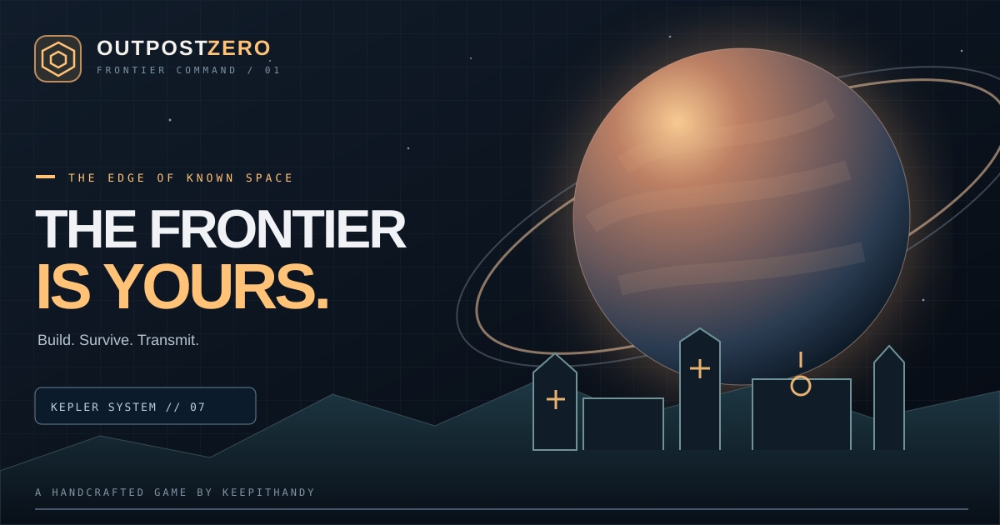

<div align="center">



<br>

# OUTPOST ZERO

### FRONTIER COMMAND / A ONE-SCREEN SCI-FI COLONY SIM

**A dying star. One last settlement. Build something worth finding.**

[](https://github.com/keepithandy/outpost-zero)
[](https://github.com/keepithandy/outpost-zero)
[](src/engine.mjs)
[](package.json)

**[Start playing](#-launch-the-game) · [Field manual](docs/FIELD_MANUAL.md) · [Game systems](#-game-systems) · [Performance research](docs/PERFORMANCE.md) · [Quality gates](#-quality--verification)**

</div>

---

> **TRANSMISSION 001 // KEPLER SYSTEM // NORTHSTAR OUTPOST**  
> Humanity's signal is fading. Your task is simple: keep the lights on, build the impossible, and send one last message into the dark.

## The game

**OUTPOST ZERO** is a fully original, local-first, browser-based sci-fi strategy game. Establish a frontier station on a hostile world, balance scarce materials and personnel, unlock a chain of increasingly advanced technologies, dispatch deep-space expeditions, and complete a five-chapter campaign to activate **The First Beacon**.

The entire game is built around a single living command interface. There is **no installation, signup, subscription, mandatory server, game framework, or runtime package download**.

<div align="center">

| BUILD | SURVIVE | TRANSMIT |
|:--:|:--:|:--:|
| Construct a 42-node outpost | Keep power and crews in balance | Research the signal and launch expeditions |
| 9 upgradeable structures | Weather, scarcity, production chains | 6 technologies / 5 campaign chapters |

</div>

## Launch the game

**Option A — Run in your browser on a local server**

```bash
git clone https://github.com/keepithandy/outpost-zero.git
cd outpost-zero
python -m http.server 4173
```

Open **http://localhost:4173** in Chrome, Safari, Firefox, or Edge.

Windows also supports `py -m http.server 4173`. The game needs a small HTTP server because native JavaScript modules and same-origin SVG symbols are not consistently available from `file://` URLs.

**Option B — Static web hosting**

Publish the repository root to GitHub Pages, Cloudflare Pages, Netlify, or another ordinary static host. All runtime paths are relative, so a subpath deployment works without a build step.

> No public game URL is asserted here until a static host is configured and verified.

## What is already playable

| System | Implemented gameplay |
| --- | --- |
| **Living sector** | 7 × 6 command grid, terrain classes, immutable command core, tile inspector |
| **Construction** | 9 original modules, costs, tech locks, repeat-placement mode, 3 upgrade levels, 40% decommission refunds |
| **Economy** | Scrap → alloy → signal production, rations, electricity, crew availability, resource caps |
| **Site specialization** | Ore +40% extraction; ice +35% hydroponics; dune +20% solar output |
| **Research** | Sequential six-protocol tech tree with major power, staffing, and defensive breakthroughs |
| **Expeditions** | 3 missions with supply costs, travel times, seeded rewards, and one active fleet slot |
| **World events** | Ion storms, damaged solar output, defenses, salvage recovery, chronological command log |
| **Progression** | 5 chapters with explicit goals and milestone resource grants; post-campaign free play |
| **Game speed** | Pause, 1×, 2×, and 4× simulation controls; shortcuts |
| **Persistence** | Local autosave, JSON import/export, schema validation, bounded 15-minute offline simulation |
| **Offline web shell** | Optional service worker and install manifest on supported HTTPS/localhost hosts |
| **Mobile UI** | Responsive layout, touch-capable grid and buttons, narrow-width styling |
| **Accessibility** | Native buttons, labels, focus indicators, reduced-motion preference, keyboard commands |

## Visual identity — all original

<div align="center">


**A custom command interface, not a generic game template.**

</div>

The game's art direction is a **dark retro-futuristic mission control system**: sandstone highlights, a warm ringed planet, intricate telemetry, scan brackets, industrial node cards, and restrained vector detailing.

The original artwork includes:

- **35+ custom-designed SVG symbols** in one same-origin sprite — resources, buildings, command controls, mission icons, system gauges, and brand marks.
- A hand-drawn panoramic launch cover in `assets/cover.svg`.
- An original vector favicon, CSS planetary illustration, custom terrain styling, map labels, and in-game UI.
- No third-party image CDN or runtime icon library. All game assets are served locally by the same static host.

The README badges are generated by shields.io when viewing the documentation online; the game itself does not use that service.

## Game systems

### 01. Build the first grid

There are 42 sector nodes in a single connected field. Each has a geological profile and may have a site advantage. Select a module in the right-side command deck, then place it on an unoccupied buildable node. Inspect any structure to improve or decommission it.

| Structure | Primary purpose | Unlock |
| --- | --- | --- |
| Ore Extractor | Generates raw scrap | Starting module |
| Solar Array | Supplies clean power | Starting module |
| Hydroponic Bay | Produces crew rations | Starting module |
| Arc Smelter | Converts scrap into alloy | Starting module |
| Crew Habitat | Expands staffed capacity | Starting module |
| Deep-Space Uplink | Converts alloy into research signal | Listening Protocol |
| Helium Reactor | High-density grid power | Helium Ignition |
| Synthesis Lab | Advanced research signal production | Autonomous Crews |
| Storm Shield | Protects power from solar storms | Magnetic Barrier |

### 02. Solve the production puzzle

```text
ORE SEAMS ─────► SCRAP ─────► ARC SMELTERS ─────► ALLOY
                     │                               │
                     └────► CONSTRUCTION             └────► UPLINK / LAB ──► SIGNAL
                              ▲                                        │
                              │                                        ▼
SUNLIGHT ──► SOLAR ARRAY ──► POWER                              NEW TECHNOLOGY
                ▲
                │
RATIONS ──► HELIUM REACTOR          CREW HABITATS ──► WORKFORCE
    ▲
    └──── HYDROPONIC BAYS
```

Every building draws power and often crew. If either supply is inadequate, global productivity is scaled down instead of silently ignoring shortages. Consumable inputs and storage caps are enforced by the simulation engine.

### 03. Send ships into the dark

| Mission | Time | Reward focus |
| --- | ---: | --- |
| **Wreck Salvage** | 22 seconds | Scrap, alloy |
| **Void Survey** | 38 seconds | Signal, alloy |
| **Deep Convoy** | 56 seconds | Large alloy and scrap shipments |

Mission time follows simulated time. A 4× speed setting accelerates construction-era progress without introducing additional rendering frames. Rewards are pseudorandom from a saved seed for consistent simulation replays.

### 04. Unlock the final transmission

Five campaign chapters move from stable mining to sustainable food, interstellar communication, a reactor-era fleet, and finally the activation of **The First Beacon**. Successful chapters unlock bonus materials to keep progression moving.

**Victory does not end the simulation.** Continue planning an optimized outpost afterward.

## Engineering philosophy

<div align="center">


</div>

The engine prioritizes **responsive interaction, structural simplicity, and portable saves**, not expensive rendering technology for its own sake.

- **No frontend dependencies:** no React, Phaser, Three.js, canvas loop, external fonts, or build tool required.
- **Small workload:** only 42 map cells, a 1 Hz simulation update, and event-driven map redraws when construction or selection changes.
- **Lightweight vector art:** one cacheable SVG symbol sheet rather than hundreds of icon image requests.
- **Explicit finite game state:** serializable data, reproducible random events, predictable versioned persistence.
- **Budgeted catch-up:** the longest offline restoration is 900 simulation steps, never unbounded.
- **Static-host ready:** plain HTML, CSS, JS, SVG, a manifest, and an optional versioned service worker.

**Speed claim policy:** this implementation is designed to be lightweight, but **we do not claim it is the fastest game on the market**. A defensible claim requires real-device field and laboratory measurements and a fair cross-game benchmark. The research links, measurement targets, and outstanding device validations live in **[docs/PERFORMANCE.md](docs/PERFORMANCE.md)**.

### Research-backed decisions

The architecture is informed by publicly documented browser guidance, not marketing scores:

| Reference | Applied decision |
| --- | --- |
| [Chrome for Developers — SVG icons](https://developer.chrome.com/docs/modern-web-guidance/guides/ui-atoms/icons) | One cacheable, same-origin symbol sprite |
| [web.dev — Optimize input delay](https://web.dev/articles/optimize-input-delay) | Avoid unnecessary callbacks and heavy main-thread updates |
| [MDN — Page Visibility API](https://developer.mozilla.org/en-US/docs/Web/API/Page_Visibility_API) | Account for hidden-tab throttling and return-time catch-up |
| [MDN — Canvas optimization](https://developer.mozilla.org/en-US/docs/Web/API/Canvas_API/Tutorial/Optimizing_canvas) | Separate static and frequently changing presentation; choose DOM/CSS for this compact tactical grid |
| [web.dev — Optimize long tasks](https://web.dev/articles/optimize-long-tasks/) | Bound simulation restoration and avoid open-ended work |

## Quality & verification

The repository includes pure simulation tests and an Actions quality gate:

```bash
npm run check
```

The command runs Node.js syntax checks and automated tests using the built-in Node 22 test runner. No `npm install` is required for the package itself.

Coverage includes deterministic expeditions, invalid terrain, affordability, resource conservation, energy/crew shortages, tech gating, three-level upgrades, save round-trips, invalid save rejection, offline catch-up limits, and milestone completion.

**Verification status:** the engine's 16 scenario tests and interface syntax/ID checks passed in the development environment. GitHub Actions and real-device visual/performance verification are separate release gates; do not mistake source-level tests for a device compatibility certification.

## Project files

```text
outpost-zero/
│
├── index.html                 Command interface & accessible UI
├── styles.css                 Visual language, responsive layout, map
├── src/
│   ├── app.mjs                 Controller, rendering, autosave, interactions
│   └── engine.mjs              Deterministic game simulation & rules
├── assets/
│   ├── icons.svg               Original symbol collection
│   ├── cover.svg               Original cinematic repository cover
│   └── favicon.svg             Custom station insignia
├── tests/
│   └── engine.test.mjs         Node simulation regression tests
├── docs/
│   ├── FIELD_MANUAL.md         Play instructions and mechanics
│   └── PERFORMANCE.md          Research, design decisions, validation plan
├── sw.js                       Optional versioned offline cache
├── manifest.webmanifest        Installable application metadata
├── package.json                Test commands; zero runtime dependencies
└── .github/workflows/ci.yml    Automated quality gate
```

## Save integrity & privacy

- Your progression stays in your browser's localStorage. No remote player profile, analytics collector, or tracking service is required.
- JSON saves can be explicitly exported and imported; imported saves are schema-checked and limited to 128 KB through the UI.
- Invalid technology and structure identifiers are filtered during save restoration.
- Manual reset requires confirmation. Clearing browser data can erase the local copy, so **export a backup** before clearing site storage or moving devices.
- In-game resource quantities are simulation values, not real money, financial instruments, or purchasable virtual currency.

## What's next

| Version | Direction | Status |
| --- | --- | --- |
| **1.0** | Playable command grid, economy, story chapters, original art and offline saves | **Implemented** |
| **1.1** | Build previews, performance telemetry overlay, richer terrain adjacency effects | Planned |
| **1.2** | Narrative signal discoveries, branching research, expanded map and mission types | Planned |
| **2.0** | Campaign variants, original ambient audio, deeper logistics and production automation | Concept |

The principle for future versions: **new depth, not more disconnected tabs**.

---

<div align="center">

**BUILT FROM SCRATCH • ORIGINAL ICONS • ZERO RUNTIME DEPENDENCIES**

Made by **[Keepithandy](https://github.com/keepithandy)**

<sub>All original project code, visual art, and game text are reserved to the repository owner unless a license is explicitly added. External research sources are credited and linked; no third-party source artwork is redistributed.</sub>

**THE FRONTIER IS YOURS.**

</div>
